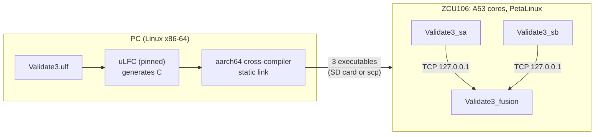

# Running micro-LF on the ZCU106 A53 Cores — Minimal Specification

| | |
|---|---|
| Status | Draft, revision 0.1, 10 November 2026 |
| Purpose | The simplest way to run micro-LF federates on the ZCU106: three Linux processes on the A53 cores, talking over TCP on the board itself. No FPGA logic. |
| Relation to other documents | Stage B1 of the [project definition](../program/lf_hardware_coordination_project_definition.md) and phase P1 of the micro-LF on FPGA project definition. The FPGA channel and fabric clock (B2) come after this and are not covered. |

Each step carries one status:

| Status | Meaning |
|---|---|
| **CI** | Ran in this repository's GitHub Actions job `a53-cross` (Ubuntu 24.04 x86-64 runner) |
| **QEMU** | The step's output ran under `qemu-aarch64` user-mode emulation, which executes A53 instructions on the PC. It shows the binaries are correct aarch64 Linux programs; its timing says nothing about the board. |
| **AMD** | Command taken from AMD's PetaLinux reference guide, UG1144 |
| **BOARD** | Not yet done on a ZCU106. To be confirmed. |

## 1 The simplest route

Build everything on a PC and copy three **statically linked** aarch64 executables to the board. A static executable carries its own C library, so the board needs only a booted Linux. No compiler, SDK, extra package or matching library version is needed on the board, and the image can be the prebuilt one in AMD's ZCU106 board support package.



*Figure 1. The whole path. The only board-specific part is booting Linux and copying three files.*

## 2 What you need

- A Linux x86-64 PC with `git`, JDK 17, CMake ≥ 3.20, `gcc-aarch64-linux-gnu`, Python 3, and network access to GitHub, Maven Central and the Gradle plugin portal (the compiler build downloads its dependencies). Optional: `qemu-user` for step S4.
- A ZCU106 with an SD card and a serial console; Ethernet if files are to be copied with `scp`.
- The PetaLinux tools and the ZCU106 BSP of the same release (from AMD's download page), or only the BSP's prebuilt images.

## 3 Steps

### S1 — Get the pinned runtime and build the compiler (CI)

```bash
git clone https://github.com/lf-lang/reactor-uc.git
git -C reactor-uc checkout --detach df7cfeae7083509621b8f5080c066051112e2500
git -C reactor-uc submodule update --init --recursive
export REACTOR_UC_PATH="$PWD/reactor-uc"
"$REACTOR_UC_PATH/ulf/gradlew" -p "$REACTOR_UC_PATH/ulf" assemble :cli:lfc:assemble
LFC="$REACTOR_UC_PATH/ulf/build/install/lf-cli/bin/lfc"
```

The compiler is the `ulf/` tree of the same reactor-uc commit, not the separate Lingua Franca compiler.

### S2 — Generate the program (CI)

Use the corrected `Validate3.ulf` from the independent review (`micro-lf/validation/Validate3.ulf` at commit [`f429e43`](https://github.com/perkusic/lingua-franca-docs/blob/f429e437f5d6db66269ec88ef4f09a73e3458adf/micro-lf/validation/Validate3.ulf)), **with `@buffer(4)` added on both connections** (Section 5):

```text
  @buffer(4)
  sa.out -> fusion.a
  @buffer(4)
  sb.out -> fusion.b
```

```bash
mkdir -p work/src && cp Validate3.ulf work/src/ && cd work
"$LFC" src/Validate3.ulf
```

This also builds x86-64 executables in `work/bin/`. They are the PC reference run. The generated projects are `work/src-gen/Validate3/fusion`, `.../sa` and `.../sb`. Each is a standalone CMake project with its own copy of the runtime.

For V2 and V3, change the program as the review's `reproduce.py` does: `@maxwait(30 ms)` becomes 100 ms for V3, and sensor B becomes `new Sensor(period = 150 ms, slow_at = 3, slow_by = 60 ms)` for V2 and V3. Generate each variant in its own directory.

### S3 — Cross-compile each federate, statically linked (CI)

Toolchain file `aarch64-linux-gnu.cmake`:

```cmake
set(CMAKE_SYSTEM_NAME Linux)
set(CMAKE_SYSTEM_PROCESSOR aarch64)
set(CMAKE_C_COMPILER aarch64-linux-gnu-gcc)
set(CMAKE_FIND_ROOT_PATH_MODE_PROGRAM NEVER)
set(CMAKE_FIND_ROOT_PATH_MODE_LIBRARY ONLY)
set(CMAKE_FIND_ROOT_PATH_MODE_INCLUDE ONLY)
```

```bash
for f in fusion sa sb; do
  cmake -S src-gen/Validate3/$f -B build-arm-$f -DCMAKE_BUILD_TYPE=Release \
        -DCMAKE_TOOLCHAIN_FILE="$PWD/../aarch64-linux-gnu.cmake" -DCMAKE_EXE_LINKER_FLAGS=-static
  cmake --build build-arm-$f --parallel
done
file build-arm-fusion/Validate3_fusion   # "ARM aarch64 ... statically linked"
```

The executables are `Validate3_fusion`, `Validate3_sa` and `Validate3_sb`, each about 0.9 MB.

### S4 — Check on the PC under emulation (CI, QEMU)

```bash
qemu-aarch64 build-arm-fusion/Validate3_fusion > fusion.log 2>&1 &
qemu-aarch64 build-arm-sa/Validate3_sa > sa.log 2>&1 &
qemu-aarch64 build-arm-sb/Validate3_sb > sb.log 2>&1 &
wait; grep '^fusion:' fusion.log
```

The three may start in any order: the sensors listen (ports 1024 and 1026 on 127.0.0.1) and fusion retries its connections until they accept. Expected results are in Section 4.

### S5 — Boot Linux on the ZCU106 (AMD, BOARD)

The simplest option is the BSP's prebuilt images, booted as UG1144 describes ("Booting PetaLinux Prebuilt Images", from SD card or JTAG). To build the image yourself, UG1144 (2024.1 and later) gives:

```bash
source <petalinux-install>/settings.sh
petalinux-create project -s <path-to>/xilinx-zcu106-<release>.bsp
cd <created project directory>
petalinux-build
```

The exact BSP file name, the boot files and how they are copied to the SD card depend on the release; follow UG1144 for the release used and record it. No change to the image is needed for this step.

### S6 — Copy and run on the board (BOARD)

Copy the three executables to the board, either onto the SD card's boot partition or with `scp` if the image runs an SSH server. Then, on the board's console:

```bash
chmod +x Validate3_*
./Validate3_fusion > fusion.log 2>&1 &
./Validate3_sa > sa.log 2>&1 &
./Validate3_sb > sb.log 2>&1 &
wait; grep '^fusion:' fusion.log; echo "exits checked by: wait"
```

Run each of V1, V2 and V3 at least five times. Keep every log and record the board image release and kernel version (`uname -a`).

## 4 Expected results

Logical results must match exactly; lags are reported but not compared.

| Run | Fusion lines expected |
|---|---|
| V1 (W = 30 ms) | tags 0, 100, 150, 200, 300, 400, 450, 500 ms; a present at multiples of 100, b present at multiples of 150; `8 reactions, 0 tardy, sum a 21, sum b 10: PASS` |
| V2 (W = 30 ms, B late) | as V1 but at tag 300 b absent, then `TARDY tag (300 ms, 1), a absent, b present`; `8 reactions, 1 tardy, ... PASS` |
| V3 (W = 100 ms, B late) | as V1, with b present at tag 300; `8 reactions, 0 tardy, ... PASS` |

All three processes must exit with status 0.

## 5 Known issue: the default buffer drops a message in V3

Without `@buffer`, the generated code gives each federated input a buffer of one message. In V3, fusion waits the full 100 ms at tag 200 and is still working on tag 200 at 300 ms, which is when sensor A sends its tag-300 value. The buffer still holds the tag-200 value, so the runtime logs `Input buffer at Connection … is full. Dropping incoming msg`. The value is lost and tag 300 runs with a absent; the run ends with `sum a 17: FAIL`.

Results of the CI job, all under emulation with generated, statically linked aarch64 code:

| Program | V1 (5 runs each CI run) | V2 | V3 | Sweep W55–W70 |
|---|---|---|---|---|
| Default buffer (one message) | all pass | all pass | **4 of 13 runs fail**, each with the "input buffer is full" message (3 CI runs) | all pass |
| `@buffer(4)` on both connections | 5 of 5 pass | 5 of 5 pass | 5 of 5 pass, no message dropped | 7 of 7 pass |

Evidence: CI run [42794671897](https://github.com/perkusic/lingua-franca-docs/actions/runs/42794671897), logs in `ci-results/a53-cross/` and `ci-results/a53-cross-buffer4/` on branch `ci/a53-cross` at commit [`f6f232c`](https://github.com/perkusic/lingua-franca-docs/tree/f6f232cc4d1c130a73cd1bda7acd3d6bd77ac7a3/ci-results). The earlier x86-64 runs passed only because their timing avoided the overlap; the same overlap can occur on the A53. The buffer size is set per connection with `@buffer(n)`, which reactor-uc's own tests use (for example `test/lf/src/legacy/CompositionAfter.ulf`).

Use `@buffer(4)` for the board runs. A drop at a full buffer is a runtime behaviour to report upstream: the message is logged and discarded, and the run continues with a wrong logical result.

## 6 Not covered

- The FPGA: no bitstream and no fabric channel or counter. That is stage B2; see the project definition.
- Running the micro-LF compiler on the board, and timing claims of any kind. Lags measured on the board are reported as observations of that image and load, not as bounds.

## 7 References

1. `lf-lang/reactor-uc`, commit `df7cfeae7083509621b8f5080c066051112e2500` (7 September 2026): runtime and the `ulf/` compiler.
2. Independent review and corrected program: [`micro-lf/validation/`](https://github.com/perkusic/lingua-franca-docs/tree/f429e437f5d6db66269ec88ef4f09a73e3458adf/micro-lf/validation) at commit `f429e437f5d6db66269ec88ef4f09a73e3458adf`.
3. CI job and evidence: [`ci/a53_cross.py`](https://github.com/perkusic/lingua-franca-docs/blob/f6f232cc4d1c130a73cd1bda7acd3d6bd77ac7a3/ci/a53_cross.py) and [`.github/workflows/a53-cross.yml`](https://github.com/perkusic/lingua-franca-docs/blob/f6f232cc4d1c130a73cd1bda7acd3d6bd77ac7a3/.github/workflows/a53-cross.yml), branch `ci/a53-cross`, commit `f6f232cc4d1c130a73cd1bda7acd3d6bd77ac7a3`.
4. AMD, *PetaLinux Tools Documentation: Reference Guide* (UG1144): [Creating a Project from a BSP (2024.1)](https://docs.amd.com/r/2024.1-English/ug1144-petalinux-tools-reference-guide/Creating-a-Project-from-a-BSP); [Building the project using BSP Flow](https://docs.amd.com/r/en-US/ug1144-petalinux-tools-reference-guide/Building-the-project-using-BSP-Flow).
