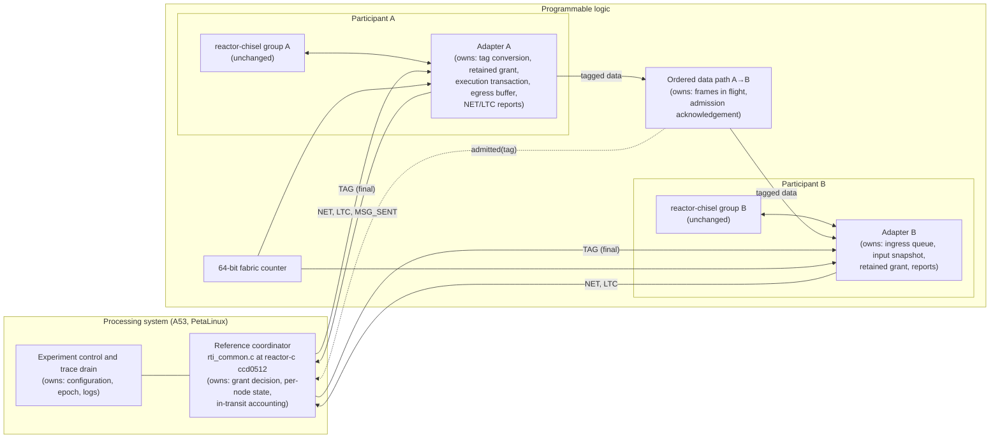
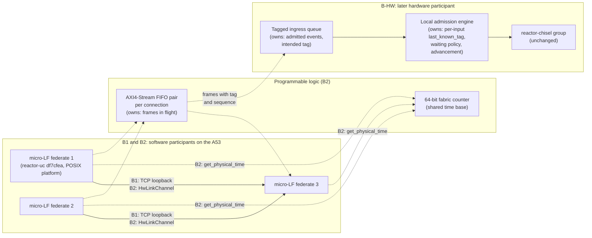
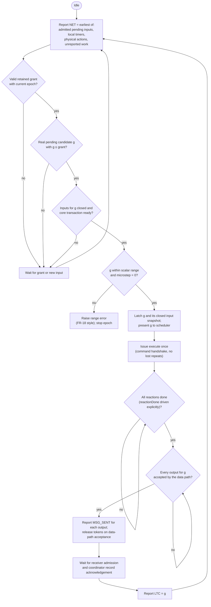
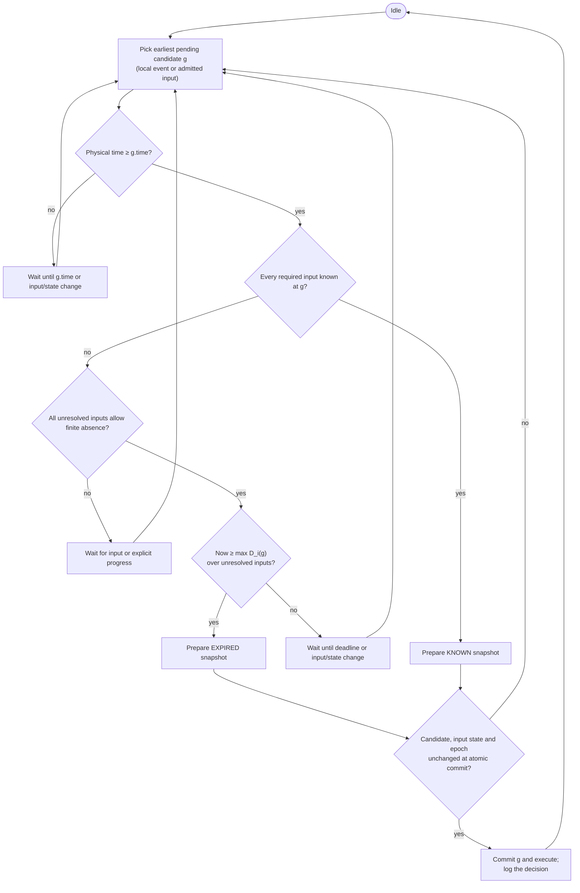
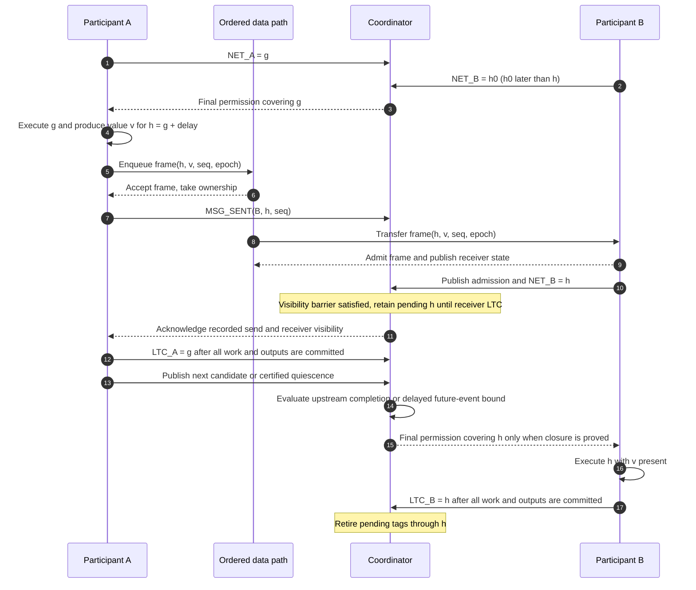

# Centralized and Decentralized Coordination for LF Hardware on the AMD ZCU106 — Project Definition

**Table 1 — Document status.**

| | |
|---|---|
| Status | Draft for review, revision 0.1 |
| Date | 9 November 2026 |
| Technical basis | *Centralized and Decentralized Coordination for LF Hardware*, expanded technical design note of 8 October 2026 (the **design note**), treated here as a design proposal |
| Other inputs | The HW-RTI specification, the hardware coordination implementation guide, the micro-LF FPGA design note, the Linux validation example and its independent review (all in [`perkusic/lingua-franca-docs`](https://github.com/perkusic/lingua-franca-docs); see [Section 15](#15-references)) |
| Preserved | The design note and every canonical project document are unchanged. Proposed edits to them are listed separately in [`lf_hardware_coordination_proposed_changes.md`](lf_hardware_coordination_proposed_changes.md). |

## How to read this document

Every factual statement carries one evidence label. An unlabelled statement is a definition, a plan or a requirement.

**Table 2 — Label and Meaning.**

| Label | Meaning |
|---|---|
| **[SRC]** | Checked in the source code at the pinned commit given in the citation. Inspection only: nothing was built or run on the board. |
| **[PORT]** | Reported about the existing ZCU106 reactor-chisel port. The port's source revisions and board artifacts were not available for this definition, so it has not been audited. |
| **[LNX]** | Demonstrated by the Linux validation experiment (x86-64, TCP loopback). These are **not** ZCU106 measurements and not worst-case bounds. |
| **[SPEC]** | Stated in a canonical project specification. It describes intended behaviour; nothing labelled [SPEC] has been implemented unless another label says so. |
| **[PROP]** | Proposed by the design note or by this definition; to be built and tested. |
| **[EST]** | Planning estimate. Not measured. |

Pinned revisions used throughout (full hashes in [Section 15](#15-references)):

**Table 3 — Short name and Repository.**

| Short name | Repository | Commit | Date |
|---|---|---|---|
| reactor-chisel runtime | `erlingrj/reactor-chisel` | `d94dd2d` | 5 Jun 2024 |
| Codesign compiler | `erlingrj/lingua-franca` | `f60c83c` (its reactor-chisel submodule is `6c8aecd`) | 7 Jan 2024 |
| micro-LF runtime and compiler | `lf-lang/reactor-uc` (the `ulf/` tree is the compiler) | `df7cfea` | 7 Sep 2026 |
| C RTI reference | `lf-lang/reactor-c` | `ccd0512` | 26 Sep 2026 |
| Linux review evidence | `perkusic/lingua-franca-docs`, branch `codex/review-micro-lf` | `f429e43` | 9 Nov 2026 |

---

### Gate register

A gate passes only after its stated conditions are met and the evidence is archived with its commit. Milestones and test identifiers are defined in [Section 10](#10-milestones-and-gates) and [Section 11](#11-requirements-and-tests).

**Table 4 — Gate and Opens.**

| Gate | Opens | Pass conditions |
|---|---|---|
| **G-A0** | M-A1 | The port's revisions (reactor-chisel, LF fork, Vivado, PetaLinux) are recorded; the original Codesign example is rebuilt from the manifest and reproduces its expected output on the board; every [SRC] finding of Section 4.1 is re-checked at the port's revision; OQ-8 is decided. |
| **G-A1** | M-A2 | Adapter unit tests T-A1 to T-A4 pass in simulation against the reference transition model; the input-closure argument of Section 7.3 is written and reviewed; AS-3 is demonstrated in simulation for two independently addressed blocks; the reference policy and board binding pass delayed-data and absence trace checks. |
| **G-A2** | M-A3, and the hardware participant of B-HW | The first-milestone acceptance trace ([Section 10.3](#103-first-milestone-acceptance-trace)) is produced on the board and matches the software reference. |
| **G-A3** | M-A4 | The HW-RTI has passed its own milestone for correct grants on acyclic federations (its M-2) **[SPEC]**, and the integrated data/control binding is verified against the adapter contract; a decision-core result alone does not prove board integration. |
| **G-B1** | B2 | B1 runs on the A53 with generated code; logical traces match the Linux reference for every case; per-process exit statuses and logs are archived. |
| **G-B2** | B-HW1, together with G-A2 | HwLinkChannel passes T-B3 (ordering, frame limit, full FIFO, timeout, reset with epoch); the coherent counter read passes T-B4; traces over TCP and FIFO satisfy MR-B2. B2 itself does not depend on Track A. |
| **G-B3** | B-HW2 | B-HW1 shows no premature absence and live progress on its declared topology; a written timing budget (Section 8.4) exists for each input that will get a finite allowance, with its violation response. |

## 1 Summary

The project compares two coordination approaches on one AMD ZCU106 board. Track A uses reactor-chisel hardware participants; Track B starts with software federates and introduces a hardware participant only in a later experiment.

- **Track A — centralized.** Two independently controlled hardware participants run under **final tag-advance grants** (TAG) from a coordinator, on a static acyclic topology with explicit connection delays. The starting point is the coordination interface that the original Codesign flow already has (`TAG`, `NET`, `LTC`, `WRITE`, `READ`). That interface is an execution protocol between one software program and one hardware block. It is not a federation runtime, so Track A must adapt four of its semantics: tag representation, grant validity, input closure and completion ([Section 7](#7-track-a-semantics-that-must-be-adapted)).
- **Track B — decentralized.** The software reference is micro-LF (`reactor-uc`). Work begins with micro-LF federates on the A53 cores under Linux over TCP loopback, then replaces TCP with a fabric channel and a shared fabric time base. A later, separate experiment gives one *hardware* participant local advancement: first by explicit input knowledge only, then with finite waiting and tardy handling.

**Recommendation.** Make Track A the first **hardware federation milestone** (M-A2, [Section 10](#10-milestones-and-gates)), on one condition: a grant policy that has been verified for the chosen topology must exist before any grant reaches the FPGA. At the date of this definition the project HW-RTI is a specification with no implementation **[SPEC]**, so the first milestone proposes a serialized A53 coordinator using the reference C algorithm (`rti_common.c` of reactor-c `ccd0512`). The board service and its data-plane ordering must pass G-A1; neither is established by the standalone trace oracle. That reference coordinator is replaced by the HW-RTI when the HW-RTI reaches its own integration milestone. Track B's Linux and A53 work (B1, B2) does not depend on Track A and can proceed in parallel.

Peer-to-peer transport does not make coordination decentralized. Coordination is decentralized only when each participant decides by itself when it may advance; where the payloads travel is a separate choice ([Section 3.1](#31-coordination-is-not-transport)).

## 2 Motivation

### 2.1 Why hardware participants need coordination

Reactors in different participants run concurrently. Each one must still agree on the logical order of events, because that order decides which reactions run and with what inputs. At a candidate tag *g*, a receiver whose input has no value must tell two cases apart: the input is **known to be absent** at *g*, or a value for *g* is still on its way. A local timer alone cannot tell them apart. Without coordination, a reaction can run at *g* before causally earlier remote data is visible, and the result depends on transport timing rather than on the program.

Coordination answers three questions: when a participant may commit to a tag; which inputs belong to that tag; and what "complete" means for downstream participants.

### 2.2 Why the Codesign wrapper is the right starting point, and what it is not

The Codesign flow in the `erlingrj` fork of LF already splits one LF program into a software part and a hardware part, and connects them through a small coordination interface **[SRC]**:

- The compiler generates a C++ program that, for each logical time at which the hardware has work, writes the grant (`set_coordination_tagAdvanceGrant(now32)`), issues `WRITE`, busy-waits until `logicalTagComplete` equals that time, forwards the hardware outputs, issues `READ`, and schedules the next hardware event from `nextEventTag` ([`CodesignFpgaWrapperTransformation.java` L374–L424](https://github.com/erlingrj/lingua-franca/blob/f60c83c5fbf0f0c26c780c28e58e50c0fc60a608/core/src/main/java/org/lflang/ast/CodesignFpgaWrapperTransformation.java#L374-L424)). The software side is generated for the Cpp target ([`CodesignSwEmitter.kt` L74](https://github.com/erlingrj/lingua-franca/blob/f60c83c5fbf0f0c26c780c28e58e50c0fc60a608/core/src/main/kotlin/org/lflang/generator/codesign/CodesignSwEmitter.kt#L74)).
- The hardware exposes `nextEventTag`, `tagAdvanceGrant`, `logicalTagComplete` and a shutdown command ([`TriggerGenerator.scala` L15–L25](https://github.com/erlingrj/reactor-chisel/blob/d94dd2d272ce46145ac13c3c6a141bc2ba9dfca1/src/main/scala/TriggerGenerator.scala#L15-L25)), and its scheduler executes only when the grant permits ([`Scheduler.scala` L36–L48](https://github.com/erlingrj/reactor-chisel/blob/d94dd2d272ce46145ac13c3c6a141bc2ba9dfca1/src/main/scala/Scheduler.scala#L36-L48)).

This is valuable because it already has the shape a federate needs: an execution gate controlled from outside, a next-event report and a completion report. It is **not** a federation runtime **[SRC]**: there is exactly one software controller and one hardware block; the grant is the software program's own logical time, not the result of evaluating a topology; there is no notion of upstream participants, connection delays, messages in transit or absence. Track A keeps the interface and replaces the policy behind it.

### 2.3 Why both coordination styles

**Table 5 — Concern and Centralized (Track A).**

| Concern | Centralized (Track A) | Decentralized (Track B) |
|---|---|---|
| Authority to advance | A verified grant policy evaluates the whole topology | Each participant, from its own input knowledge and waiting policy |
| An input with no value at *g* | Resolved by the protocol before a final grant for *g* | Waited for until known, or assumed absent under an explicit, configured policy |
| Main integration risk | Progress reports and grant meanings do not match the policy's assumptions | The local policy or its timing assumptions are incomplete |
| Failure behaviour | A stalled coordinator or a missing report stops progress (safe, not live) | A lost peer can stall progress or, with finite waiting, trigger a configured violation |
| Cost | Report traffic, grant arbitration, dependence on one coordinator | Replicated knowledge state; every finite wait must be justified; late data must be handled |

Neither style is faster or simpler in general. On one FPGA the timing assumptions behind decentralized coordination are easier to state, which is why the HW-RTI specification asks whether decentralized coordination would suffice (open question OQ-7) **[SPEC]**. This project produces evidence for that question; it does not answer it by measurement alone ([Section 12.3](#123-contribution-to-oq-7)).

## 3 Research questions, scope and assumptions

### 3.1 Coordination is not transport

Two choices are independent and are kept apart in every design and every result:

- **Who decides advancement** (centralized or decentralized coordination).
- **How payloads travel** (through a router that the coordinator observes, or directly between peers).

A central coordinator does not have to route payloads. Direct peer channels do not make advancement decentralized. Whatever the routing, a grant to the receiver must not be issued until the coordinator can show that every message the receiver needs for that tag is visible at the receiver's input ([Section 7.3](#73-input-closure)).

### 3.2 Research questions

**Table 6 — ID and Question.**

| ID | Question | Track |
|---|---|---|
| RQ-1 | Can two reactor-chisel participants on the ZCU106 execute as an LF federation under final grants from a verified policy, with the logical trace of the software reference? | A |
| RQ-2 | Which changes to the Codesign interface are needed for that, and can they be confined to a participant adapter, leaving the reactor-chisel scheduler unchanged? | A |
| RQ-3 | On the A53 under Linux, what is the waiting behaviour of micro-LF federates over TCP, and how does it change when the channel and the clock source are changed one at a time to a fabric FIFO and a fabric counter? | B |
| RQ-4 | Can a hardware participant advance locally using explicit input knowledge only, without a finite wait, and remain live on the declared topology? | B |
| RQ-5 | When finite waiting is added, what timing argument justifies a waiting allowance, and what does a violation look like at the hardware boundary? | B |
| RQ-6 | What evidence from RQ-1 to RQ-5 bears on OQ-7, and what must come from the target applications instead? | both |

### 3.3 Scope

**In scope**

- Track A: a participant adapter around the reactor-chisel `CoordinationIO`; a reference coordinator on the Arm cores running the reactor-c grant algorithm; a two-participant acyclic federation with explicit positive connection delays, bounded channels and final grants; instrumentation and trace comparison; later, replacement of the reference coordinator by the HW-RTI.
- Track B: micro-LF federates on the A53 over TCP (B1); a fabric channel and fabric counter (B2); a local admission engine for one hardware participant, first known-input only (B-HW1), then finite waiting with tardy handling (B-HW2).
- Common: a source manifest, a topology manifest, a tag contract, event and progress record formats, a reference transition model per policy, a trace schema and a differential test harness.

**Explicit exclusions**

- Provisional grants (PTAG), zero-delay cycles through hardware participants, and next-downstream-event messages (DNET) to hardware participants. The HW-RTI specification already rejects topologies in which a hardware participant is in a zero-delay cycle (FR-20) **[SPEC]**.
- Mixed coordination (one federation using both policies) and switching policy at run time.
- Synthesis of reaction bodies beyond what reactor-chisel already generates; changes to reactor-chisel or reactor-uc beyond the adapter, channel and platform files. Suspected defects are reported upstream.
- Rollback or speculative execution.
- Off-board transports, multi-board federations, transient participants, authentication.
- Treating any Linux measurement as a ZCU106 result or as a worst-case bound.

### 3.4 Assumptions, each with what happens if it fails

**Table 7 — ID and Assumption.**

| ID | Assumption | Evidence today | If it fails |
|---|---|---|---|
| AS-1 | The existing ZCU106 reactor-chisel port builds and reproduces the original Codesign example | **[PORT]** reported to work; revisions not recorded | M-A0 fails; Track A cannot start. Track B (B1, B2) is unaffected. |
| AS-2 | The port's reactor-chisel sources match `d94dd2d` in the files cited here | **[SRC]** `6c8aecd` (the compiler's submodule) and `d94dd2d` differ only in `LICENSE` and `README.md`; the port's own revision is unknown | Every [SRC] claim about reactor-chisel must be re-checked against the port's revision at M-A0. |
| AS-3 | Two reactor-chisel top-level blocks, each with its own `CoordinationIO`, can be placed in one bitstream and controlled independently | Not established. The Codesign flow generates one hardware block per program **[SRC]**; whether the port's platform wrapper accepts two is unknown | Extend the platform wrapper before M-A2. A hardware/software smoke test is useful but does not satisfy the two-hardware-participant milestone. |
| AS-4 | The reference C grant algorithm can be run on the A53 as the coordinator of hardware participants | **[SPEC]** HW-RTI M-0 plans a standalone trace shim. An A53 service with board I/O, lifecycle and admission ordering is additional **[PROP]** work | Keep the trace oracle for simulation and block M-A2 until a verified board coordinator is available. |
| AS-5 | A53 user space can read a fabric counter coherently and drive AXI4-Stream FIFOs through UIO | **[PROP]** DEC-09, DEC-10 of the implementation guide; nothing built | B2 measures the TCP-to-FIFO step only after a coherent multiword read is shown (T-B4). |

## 4 What exists, what was shown, what remains

This section separates the four kinds of evidence the project starts from.

### 4.1 Verified in the original Codesign source [SRC]

All at reactor-chisel `d94dd2d` and the Codesign compiler `f60c83c`. Line numbers link to pinned permalinks.

**Table 8 — Finding and Consequence for Track A.**

| Finding | Consequence for Track A | Source |
|---|---|---|
| The hardware tag is a 32-bit `UInt` of time with no microstep. `FOREVER` is `Int.MaxValue`; `NEVER` is `Int.MinValue` reinterpreted as unsigned, so in unsigned comparisons `NEVER` (0x8000_0000) compares **above** `FOREVER` (0x7FFF_FFFF). | Tags must be converted at the adapter, sentinels mapped explicitly, and out-of-range or non-zero-microstep tags rejected. | [`Tag.scala` L4–L29](https://github.com/erlingrj/reactor-chisel/blob/d94dd2d272ce46145ac13c3c6a141bc2ba9dfca1/src/main/scala/Tag.scala#L4-L29) |
| The software wrapper truncates its logical time to 32 bits (`static_cast<std::int32_t>(now.count())`) before using it as the grant. With nanoseconds that is about ±2.1 s. | Programs longer than the scalar range cannot be granted correctly without an adapter that handles the epoch. | [`CodesignFpgaWrapperTransformation.java` L374](https://github.com/erlingrj/lingua-franca/blob/f60c83c5fbf0f0c26c780c28e58e50c0fc60a608/core/src/main/java/org/lflang/ast/CodesignFpgaWrapperTransformation.java#L374) |
| The scheduler asserts that a valid grant is not greater than `nextEventTag` unless it is `FOREVER` ("TAG > NET not allowed yet"). | A coordinator that grants beyond the participant's next event (normal in LF) violates the assertion. Clamping alone is insufficient; see [Section 7.2](#72-grant-validity) for the required transaction and liveness checks. | [`Scheduler.scala` L48](https://github.com/erlingrj/reactor-chisel/blob/d94dd2d272ce46145ac13c3c6a141bc2ba9dfca1/src/main/scala/Scheduler.scala#L48) |
| Local events execute when the grant is valid and ≥ the next event and physical time has reached it; "external" events execute when the grant is ≤ the next event and software has marked inputs present. | External execution additionally requires both valid flags and physical time at least the grant. Input presence must come from the selected, closed snapshot. | [`Scheduler.scala` L36–L46, L53–L72](https://github.com/erlingrj/reactor-chisel/blob/d94dd2d272ce46145ac13c3c6a141bc2ba9dfca1/src/main/scala/Scheduler.scala#L36-L72) |
| Grant validity is a register set by `WRITE` and cleared when an execution with an external event fires. Validity, grant value and input publication are therefore coupled in one command. | Grant validity must be separated from input publication. | [`CodesignTopReactor.scala` L175–L182](https://github.com/erlingrj/reactor-chisel/blob/d94dd2d272ce46145ac13c3c6a141bc2ba9dfca1/src/main/scala/CodesignTopReactor.scala#L175-L182) |
| `SwCommand` forwards a command only when its value differs from the previous one. | Two identical consecutive commands (for example two `WRITE`s) are seen as one. A command handshake that cannot lose repeats is needed. | [`CodesignTopReactor.scala` L16–L28](https://github.com/erlingrj/reactor-chisel/blob/d94dd2d272ce46145ac13c3c6a141bc2ba9dfca1/src/main/scala/CodesignTopReactor.scala#L16-L28) |
| `READ` releases output tokens (`consume`); `WRITE` latches input presence. | Keep an acknowledgement equivalent to `READ` for output-token release. | [`CodesignTopReactor.scala` L295–L299](https://github.com/erlingrj/reactor-chisel/blob/d94dd2d272ce46145ac13c3c6a141bc2ba9dfca1/src/main/scala/CodesignTopReactor.scala#L295-L299) |
| `LtcHandler` reports completion of a tag when **every output port has fired** once for it; with no outputs it reports completion when an input port is ready again. The completion register starts at `NEVER` (which compares above `FOREVER`). | Completion is tied to output-adapter firing, not to downstream visibility. The adapter must report LTC only after the required output commitment ([Section 7.4](#74-completion-with-buffered-or-delayed-outputs)). | [`CodesignTopReactor.scala` L76–L122](https://github.com/erlingrj/reactor-chisel/blob/d94dd2d272ce46145ac13c3c6a141bc2ba9dfca1/src/main/scala/CodesignTopReactor.scala#L76-L122) |
| `reactionDone` defaults to `true`. | A multi-cycle body must hold it low until done; this signal controls the reaction state machine, not the whole-participant LTC by itself. | [`Reaction.scala` L144–L145](https://github.com/erlingrj/reactor-chisel/blob/d94dd2d272ce46145ac13c3c6a141bc2ba9dfca1/src/main/scala/Reaction.scala#L144-L145) |
| The trigger generator asserts that the scheduler never fires the same tag twice except for shutdown. | Same-tag events may be processed together; independent executions at the same scalar tag cannot represent distinct microsteps. | [`TriggerGenerator.scala` L135–L137](https://github.com/erlingrj/reactor-chisel/blob/d94dd2d272ce46145ac13c3c6a141bc2ba9dfca1/src/main/scala/TriggerGenerator.scala#L135-L137) |
| The wrapper rebuilds a 64-bit next-event time as `nextEventTag + (now.count() >> 32)`, adding the upper word without shifting it back. | The reconstruction is incorrect for a nonzero upper word under the same-epoch interpretation; the wrapper has no compensating high-word scale. Whether the working port reaches or contains this path is open. | [`CodesignFpgaWrapperTransformation.java` L423–L424](https://github.com/erlingrj/lingua-franca/blob/f60c83c5fbf0f0c26c780c28e58e50c0fc60a608/core/src/main/java/org/lflang/ast/CodesignFpgaWrapperTransformation.java#L423-L424) |

### 4.2 What the existing ZCU106 port provides [PORT]

- Reported: a reactor-chisel ZCU106 port works. This does not establish a reproducible single-block build or validate any particular wrapper, interface or source revision.
- Not available for this definition: the port's repository, its reactor-chisel and LF-fork revisions, its Vivado and PetaLinux versions, its platform wrapper (which carries `WRITE`/`READ` and the coordination registers to software) and any build or run logs.

**Uncertainty that follows.** The findings of [Section 4.1](#41-verified-in-the-original-codesign-source-src) may not hold for the port if its revisions differ. Whether the port can host two independently controlled blocks (AS-3), how its registers are mapped and at what rate the A53 can poll them are unknown. These are closed in M-A0 by recording the port's revisions in the source manifest and re-checking every [SRC] line against them.

### 4.3 What the Linux experiment demonstrated [LNX]

A three-federate micro-LF program (two sensors, one fusion federate with `@maxwait`) was run at reactor-uc `df7cfea`, first as hand-written C and then, after an independent review, as C generated by the pinned compiler.

**Table 9 — Result and Status.**

| Result | Status |
|---|---|
| The micro-LF source failed to compile because `tardy` is a reserved word; after renaming the state variable, disabling clock sync explicitly and adding trace fields, the pinned `ulf` compiler generated C that builds and runs on Linux without patches to the generated C or runtime. | Shown (review host: Ubuntu 24.04, x86-64, 4 logical CPUs, TCP loopback) |
| All 48 timed runs (24 hand-written, 24 generated) matched the reference logical outcomes: tag, microstep and presence of every ordinary and tardy reaction, counts, sums and three successful process exits. | Shown |
| With sensor B 60 ms late at tag 300 ms, `@maxwait` of 55, 59 and 60 ms gave one tardy event in each of three attempts; 61, 62, 65 and 70 ms gave none. **61 ms was the smallest successful tested value on that host.** It is not a bound for other loads, other hosts or the ZCU106. | Shown (3 attempts per value) |
| In the hand-written V3 run, tag 500 ms was released at about 550 ms of physical time by a **TCP disconnect**: the closed channel wakes the waiting scheduler and is then skipped by the acquisition scan. It was not released by a value from B, a stop message or the tag's own deadline. | Shown in a debug trace and explained at source level |
| Generated C differs from the hand-written reference in queue capacities (5/16/2 for each sensor and 6/25/2 for fusion, against 32/32/32), keep-alive (false for the sensors), TCP setup (sensors listen, fusion connects, different ports), input buffer capacity (1 against 5) and clock-sync default (on unless disabled). | Shown by diff |
| At reactor-uc `df7cfea`, "known" and "expired" are not distinct runtime results: both paths return `LF_OK`. A queue insertion failure in the dynamic scheduler terminates the process. A late message is retried at the receiver's current tag with the microstep incremented; the retry can fail. | **[SRC]** per the review's pinned citations |

Source: [`REVIEW_codex.md` at `f429e43`](https://github.com/perkusic/lingua-franca-docs/blob/f429e437f5d6db66269ec88ef4f09a73e3458adf/micro-lf/validation/REVIEW_codex.md), on branch `codex/review-micro-lf` (not yet merged into `main`). The earlier hand-written measurements on Linux 6.18 x86-64 are kept as a separate, older reference.

### 4.4 What remains to be built or tested on the board

No ZCU106 execution evidence for either track was available for this definition **[PORT]**. In particular: no participant adapter, no reference coordinator connected to hardware, no HW-RTI RTL (the specification's status is "Proposed. No implementation exists" **[SPEC]**), no fabric channel, no fabric counter, no micro-LF build for the A53, no local admission engine, and no board measurements available for this review.

## 5 Architecture

### 5.1 Track A — centralized block architecture

*Figure 1. Track A for milestone M-A2. Control flows through the coordinator; data flows on its own ordered path, which tells the coordinator when a frame has been admitted at B. In M-A4 the reference coordinator is replaced by the HW-RTI in the programmable logic, with the same adapter contract.*

Ownership of decisions and buffers:

**Table 10 — Item and Owner.**

| Item | Owner | Notes |
|---|---|---|
| Whether participant *p* may execute at tag *g* | Coordinator (grant policy) | The adapter may further restrict, never extend. |
| Which candidate to execute under a valid grant | Adapter, then the reactor-chisel scheduler | A grant is permission, not an instruction to create an event. |
| Input snapshot for an execution | Receiving adapter | Latched once per execution; not changed while executing. |
| Frames in flight A→B | Ordered data path | Owned until B's adapter acknowledges admission. |
| Output tokens of A | A's adapter | Held until the data path acknowledges acceptance of the frame; that acknowledgement plays the role of `READ`. |
| NET and LTC reports | Each adapter | Built from admitted inputs, local timers and executing state ([Section 7](#7-track-a-semantics-that-must-be-adapted)). |
| Epoch and reset | Experiment control | Every record carries the epoch; stale epochs are discarded. |

**Design choice to settle (OD-1).** The HW-RTI specification routes no payloads: participants exchange data over their own connections and the coordinator learns about messages through a `MSG_SENT` notification (non-goal NG-6) **[SPEC]**. The design note prefers, for the first experiment, a data path whose delivery is visible to the coordinator. The two are compatible if the coordinator does not grant *g* to B while a message for B at a tag ≤ *g* has been sent but not yet admitted. Figure 1 shows a proposed visibility barrier: `MSG_SENT` records the destination tag, admission clears the separate visibility obligation, and the reference pending-tag entry remains until receiver LTC. Which variant is used, and the argument that it gives input closure, must be fixed before G-A1 ([Section 7.3](#73-input-closure)).

### 5.2 Track B — decentralized block architecture

*Figure 2. Track B. B1 and B2 change one thing at a time on the A53 (the channel, then the clock source). B-HW is a separate later experiment: one hardware participant whose advancement is decided by a local admission engine, using the same channel.*

**Table 11 — Item and Owner.**

| Item | Owner | Notes |
|---|---|---|
| Whether a participant may execute at *g* | That participant's runtime (B1, B2) or local admission engine (B-HW) | No per-tag grant from anywhere else. Exactly one authority per participant at a time. |
| Per-input knowledge (`last_known_tag`) | Receiving participant | Updated only from admitted events or explicit absence/progress records of that connection. |
| Waiting policy (none, or finite allowance per input) | Receiving participant, from configuration | Fixed per experiment; reported with every result. |
| Frames in flight | The channel (TCP socket, or FIFO) | Ordered per connection; loss and reset behaviour is part of the channel contract (MR-B3). |
| Startup, shutdown, clock distribution | A53 service | Allowed to remain centralized; it never grants tags. |
| Violation (tardy) response | Receiving participant | Declared per input before the experiment ([Section 8.4](#84-timing-budget-and-violation-response)). |

## 6 Advancement policies

### 6.1 Centralized participant flow (Track A, final grants)

*Figure 3. Proposed participant flow under final grants **[PROP]**. The guard combines permission from the coordinator with local conditions; it does not replace the grant algorithm.*

### 6.2 Decentralized flows (Track B)

Start B-HW2 only after B-HW1 passes its gate. Treat peer loss as an explicit fault or epoch transition; do not silently discard an unresolved input.

*Figure 4. Proposed decentralized admission **[PROP]**. B-HW1 has no finite absence policy. B-HW2 checks the latest deadline among unresolved inputs and commits the snapshot atomically with respect to arrival and reset.*

**[SRC]** In reactor-uc, the dynamic scheduler waits for the candidate's physical time and calls acquisition, which scans connected bundles, takes the maximum positive `max_wait` for unresolved inputs and waits until the candidate time plus that maximum. Notification can restart selection. Neither KNOWN nor EXPIRED is a distinct return value, and per-input locks do not make the scan and commit one atomic snapshot ([`src/environments/federated_environment.c` L41–L61 and L89–L121](https://github.com/lf-lang/reactor-uc/blob/df7cfeae7083509621b8f5080c066051112e2500/src/environments/federated_environment.c#L41-L121), [`src/schedulers/dynamic/scheduler.c` L341–L385](https://github.com/lf-lang/reactor-uc/blob/df7cfeae7083509621b8f5080c066051112e2500/src/schedulers/dynamic/scheduler.c#L341-L385); revision in Section 15). Explicit absence/progress records, fault on disconnect and atomic recheck are intentional hardware policy changes **[PROP]**.

**[PROP]** A later-tagged arrival establishes earlier knowledge only with monotone sends and ordered, lossless admission on that connection. Independently of the execution loop, ingress classifies arrivals at or before the **committed** frontier, including an executing tag, as tardy; it preserves the intended tag in the diagnostic record. The pinned software preserves `intended_tag` and may retry a past-tag rejection at the current logical time with microstep incremented **[SRC]** ([`include/reactor-uc/event.h` L9–L10, L31](https://github.com/lf-lang/reactor-uc/blob/df7cfeae7083509621b8f5080c066051112e2500/include/reactor-uc/event.h#L9-L31), [`src/federated.c` L218–L239](https://github.com/lf-lang/reactor-uc/blob/df7cfeae7083509621b8f5080c066051112e2500/src/federated.c#L218-L239)). The scalar hardware milestone uses an out-of-band response, not that retry.

### 6.3 One tagged value from sender to receiver completion (Track A)

*Figure 5. Proposed ordered transaction **[PROP]**. The example chooses a next upstream event whose earliest possible destination tag is strictly greater than h. Receiver NET identifies work; upstream completion and future-event bounds establish authorization. Acknowledgements in this figure belong to the proposed board binding, not the reference wire protocol.*

## 7 Track A: semantics that must be adapted

Each item gives what the source does today **[SRC]**, why it is not enough for a federation, the adaptation **[PROP]**, and the test that checks it.

### 7.1 Tag representation

- **Today.** A 32-bit unsigned scalar of nanoseconds, no microstep, `NEVER` comparing above `FOREVER`; the software truncates its logical time to 32 bits ([Section 4.1](#41-verified-in-the-original-codesign-source-src)).
- **Why not enough.** The coordinator and the C reference use a 64-bit signed time and a 32-bit microstep; comparisons on the raw scalar give wrong answers at the sentinels and beyond about 2.1 s.
- **Adaptation.** The adapter converts in both directions: an explicit epoch (start time) is subtracted before narrowing; sentinels map to sentinels; a time outside the scalar range, or a microstep other than 0, raises an error and stops the epoch. This is FR-20(a) of the HW-RTI specification **[SPEC]**. Widening the reactor-chisel tag instead is OQ-8, decided at M-A0.
- **Test.** T-A1 (tag round trips for every sentinel, both range ends and the rollover boundary; zero-delay connections rejected at load).

### 7.2 Grant validity

- **Today [SRC].** `WRITE` sets validity, external execution clears it, and `SwCommand` forwards value changes. The scheduler tests the **local** queue's valid NET; in its firing state it recomputes the tag and event mode from live inputs ([Section 4.1](#41-verified-in-the-original-codesign-source-src)).
- **Adaptation [PROP].** Retain the final grant at full width with epoch and validity; a grant is a ceiling, not an event. Select a closed, physically eligible pending candidate *g* with *g* ≤ grant. Compare with the core's local NET separately and hold the candidate, its snapshot and relevant core inputs stable through the execute handshake. Present only *g*; for a local candidate this is the clamp to the eligible NET, never a synthetic execution at the ceiling. Consume the execution once and rescan after NET changes. Keep grant authorization until no eligible work under it remains, subject to the progress contract. Unsupported execution tags fail explicitly; do not narrow a full-width grant ceiling as if it were an execution tag. A positive-delay predecessor can carry the maximum microstep, even when every executed candidate has microstep zero **[SRC]** ([`core/tag.c` L159–L177](https://github.com/lf-lang/reactor-c/blob/ccd05124e4b2086de045a6857702ae5636da30a6/core/tag.c#L159-L177); revision in Section 15). Reconcile this binding with the FR-20(a) interpretation at OQ-8.
- **Limitation [PROP].** FR-20(b) prescribes `min(TAG, NET)` **[SPEC]**, but the numerical clamp alone proves neither correct event selection nor liveness. When the core's NET is invalid, its external-event path also waits. At G-A1 prove that the binding provides a valid path for external-only work and preserves the selected tag across stalls, or choose the OQ-8 scheduler change. Do not claim unchanged-scheduler support before this check.
- **Test.** T-A2 covers no candidate under the ceiling, a newly arrived earlier candidate, external-only work with invalid local NET, NET changing under retained permission, stalled handshake, repeated grants and stale epochs.

### 7.3 Input closure

- **Today [SRC].** The Codesign host supplies one input vector via `WRITE`; the wrapper is not an inter-participant closure protocol ([Section 2.2](#22-why-the-codesign-wrapper-is-the-right-starting-point-and-what-it-is-not)).
- **Required invariant [PROP].** Before final permission through *g*, every required frame at or before *g* is visible to the receiver and no upstream can still produce another such frame. Evaluate upstream completion adjusted by connection delays or a strict bound on future incoming tags; admission and a receiver NET alone establish neither. Use the same checks for absence.
- **Accounting [SRC].** The C RTI records forwarded tags above receiver completion, clamps effective NET by the earliest pending tag, and retires entries through **receiver LTC**, not on admission. See [`core/federated/RTI/rti_remote.c` L543–L549](https://github.com/lf-lang/reactor-c/blob/ccd05124e4b2086de045a6857702ae5636da30a6/core/federated/RTI/rti_remote.c#L543-L549) and [L728–L766](https://github.com/lf-lang/reactor-c/blob/ccd05124e4b2086de045a6857702ae5636da30a6/core/federated/RTI/rti_remote.c#L728-L766), and [`core/federated/RTI/rti_common.c` L165–L288](https://github.com/lf-lang/reactor-c/blob/ccd05124e4b2086de045a6857702ae5636da30a6/core/federated/RTI/rti_common.c#L165-L288); revision in Section 15.
- **Adaptation [PROP].** Serialize each send announcement, visible admission, receiver NET update and subsequent upstream progress. Admission releases the separate visibility barrier; retain pending-tag accounting until receiver LTC. Do not wait for receiver LTC as a precondition for the grant that permits that LTC. Prove the invariant for OD-1 before G-A1. T-A3 includes a delivered frame followed by a still-possible earlier upstream frame, delayed admission, explicit absence and two inputs with one delayed.

### 7.4 Completion with buffered or delayed outputs

- **Today.** LTC is reported when every output port has fired once for the tag; with no outputs, when an input port is ready again; `reactionDone` defaults to true; array outputs wait for the reactor and the DMA.
- **Why not enough.** Downstream grants depend on LTC. If LTC is reported when an output is merely buffered, or before a multi-cycle reaction finishes, a downstream participant can be granted before the data exists. The "no outputs" rule uses input readiness as a proxy for completion, which has not been validated for a federation.
- **Adaptation.** LTC = *g* is reported only after (1) every reaction for *g* has finished (multi-cycle bodies drive `reactionDone`), (2) every output frame for *g* has been accepted, its `MSG_SENT` recorded and its admission visible to the receiver, as required by the proposed binding **[PROP]** for FR-19 **[SPEC]**, and (3) no causally relevant work for *g* remains unreported. With no outputs, require an explicit tag-scoped all-work-complete indication; input readiness alone is not evidence. Output tokens stay owned by the adapter until the data path acknowledges acceptance (the role `READ` has today). The next NET must not advertise a later candidate while the previous transaction still has unreported work.
- **Test.** T-A4 (multi-cycle reaction; output stalled by a full data path; reaction with no outputs; array output with DMA).

## 8 Track B plan

### 8.1 B1 — A53 Linux baseline over TCP loopback

Build and run the Linux-validated three-federate program and the tutorial micro-LF examples on the A53 under PetaLinux, generated by the pinned `ulf` compiler at reactor-uc `df7cfea` (the compiler is the `ulf/` tree of the same commit **[LNX]**). The generated configuration (queue sizes, keep-alive, TCP roles, clock sync explicitly off) is recorded, not hand-tuned. Results are the Linux reference for B2.

### 8.2 B2 — fabric channel and shared time base, one variable at a time

1. **Channel only.** Replace TCP with `HwLinkChannel` over one AXI4-Stream FIFO per direction and connection (DEC-09 **[PROP]**), keeping the A53 clock. This isolates the transport.
2. **Clock only.** Keep the channel, switch `get_physical_time` to the 64-bit fabric counter (DEC-10 **[PROP]**), after a coherent multiword read is shown.

Changing both at once would measure their combined effect (review finding B9). reactor-uc already contains an on-chip network channel for the Patmos platform (`S4NOCPollChannel`) that serves as a reference for a polled fabric channel **[SRC]** ([`s4noc_channel.h`](https://github.com/lf-lang/reactor-uc/blob/df7cfeae7083509621b8f5080c066051112e2500/include/reactor-uc/platform/patmos/s4noc_channel.h)).

The generated federates instantiate concrete TCP channel types. Using `HwLinkChannel` without editing generated files needs a supported generator option or a compatible adapter; establishing that route is part of B2, not an assumption.

### 8.3 B-HW — a later hardware participant (separate experiment)

- **B-HW1, known-input only.** One reactor-chisel participant gets a local admission engine (Figure 4, left branch). It advances only when every connected input is known at the candidate tag, from events, explicit absence records or progress records. No finite waiting. Gate: no premature absence in any trace, and live progress on the declared acyclic topology with sources that emit progress records.
- **B-HW2, finite waiting and tardiness.** Only after B-HW1 passes. The waiting allowance per input is derived from a timing budget ([Section 8.4](#84-timing-budget-and-violation-response)); tardy inputs are classified by intended tag and handled by the declared response.

B-HW is not stage B3 or B4 of the implementation guide, which build on Track A's participant infrastructure **[SPEC]**; it reuses the same adapter, buffers and execution interface but is a different policy engine. Only one engine owns advancement for a participant in a given build.

### 8.4 Timing budget and violation response

For a required input *i* at candidate *g*, define

- *B_i(g)*: a derived upper bound on the physical arrival time of *i*'s information for *g*, as observed on the receiver's clock. It includes source release and execution lag, every queue and transport delay including waiting for service under backpressure, timestamp sampling and conversion error, connection delay, receiver admission delay, clock error, and any design margin.
- *D_i(g)*: the instant at which the policy allows absence of *i* at *g* to be assumed.

Claiming "no tardiness from this assumption" requires *D_i(g)* ≥ *B_i(g)* under a stated boundary rule. This is a verification condition, not the reactor-uc `max_wait` equation; the runtime's rule (wait until *g*.time + W for the largest `max_wait` among unresolved connected inputs **[SRC]**) must be shown to meet it. If queueing or backpressure is unbounded, *B_i(g)* has not been established; an average latency, a fabric clock frequency or a shared clock do not establish it. A smaller allowance may be chosen deliberately, but it changes the contract and must be paired with a declared violation response.

**Violation response [PROP].** On the scalar core, drop and count or fault the epoch using a separate diagnostic record carrying the intended tag. A hardware tardy reaction equivalent to the software microstep retry requires a widened execution tag and changes to scheduling and completion, outside the initial milestone. Rollback is out of scope. Ordinary reactions never consume stale data after an absence decision.

## 9 Reuse map

**Table 12 — Source (pinned) and Reuse directly.**

| Source (pinned) | Reuse directly | Reuse through an adapter | Reference only (algorithm or contract) |
|---|---|---|---|
| **Original LF / reactor-c** (`ccd0512`) | Pinned `rti_common.c` decision routines as the proposed golden model; the M-0 trace shim is planned | An A53 event-loop shim maps NET, LTC, TAG and lifecycle to board records; MSG_SENT is the HW-RTI proposal for forwarding metadata | Startup, stop and join protocols; in-transit accounting; PTAG and DNET (excluded here) |
| **reactor-chisel / Codesign** (`d94dd2d`, compiler `f60c83c`) | Reaction and reactor modules, token protocols, ports, the scheduler, `LtcHandler` as a building block | `CoordinationIO` (tag conversion, retained grant, `min(TAG, NET)`, NET from admitted inputs, LTC after output commit); `SwCommand` replaced by a lossless handshake; `WRITE`/`READ` split into grant, input publication and consumption acknowledgement | The generated software wrapper's transaction order (grant, execute, poll LTC, forward outputs, release) |
| **micro-LF / reactor-uc** (`df7cfea`) | Federates, platform and generated code on the A53 (B1, B2); the `ulf` compiler | `HwLinkChannel` as a new `NetworkChannel`; a fabric-time POSIX platform variant; channel-selection route in the generator | Per-input state (`delay`, `type`, `last_known_tag`, `max_wait`, `payload_pool`, [`federated.h` L114–L118](https://github.com/lf-lang/reactor-uc/blob/df7cfeae7083509621b8f5080c066051112e2500/include/reactor-uc/federated.h#L114-L118)), the acquisition rule, `intended_tag` and the tardy retry for the B-HW engine. C structs, mutexes and pointer queues are not hardware: B-HW needs explicit storage, ownership and bounded capacity |
| **Project HW-RTI** (specification only) | Nothing yet: no implementation exists | Its port contract (`FederatePort`, FR-20) is the target contract for the Track A adapter, so the reference coordinator can later be swapped for the HW-RTI | Tag ALU, decision core and timing targets (K cycles, NFR-03) for M-A4; comparison baseline for B-HW |

## 10 Milestones and gates

Milestones use the pass conditions in the [gate register](#gate-register).

### 10.1 Gates

See [the gate register](#gate-register) for the pass conditions.

### 10.2 Milestones

**Table 13 — Milestone and Track.**

| Milestone | Track | Content | Exit | Estimate **[EST]** |
|---|---|---|---|---|
| M-A0 | A | Source manifest; matched build of the working port; reproduction of the original example; re-check of [SRC] findings | G-A0 | 2 weeks, assuming access to the port and the board |
| M-A1 | A | Participant adapter (tag conversion, retained grant, closure, completion); reference transition model; simulation tests | G-A1 | 4 weeks |
| **M-A2** | A | **First hardware federation**: two participants, reference coordinator on the A53, ordered data path, instrumentation | G-A2 | 4 weeks |
| M-A3 | A | Validation campaign (Section 12) and measurements on the board | Report | 3 weeks |
| M-A4 | A | Replace the reference coordinator by the HW-RTI | Same traces as M-A2 | Depends on the HW-RTI schedule |
| B1 | B | micro-LF on the A53 over TCP | G-B1 | 3 weeks |
| B2 | B | Fabric channel, then fabric counter | G-B2 | 6 weeks |
| B-HW1 | B | Local known-input engine for one hardware participant | G-B3 | 4–6 weeks, after G-A2 |
| B-HW2 | B | Finite waiting and tardy handling | Report | 4–6 weeks |

The estimates assume one engineer familiar with Chisel and the C runtimes, a working board image and the port. They are to be re-estimated after M-A0 and after B1, when the image, the compiler and access to the board have been shown.

### 10.3 First-milestone acceptance trace

M-A2 passes when one archived trace, from the board, shows all of the following for a federation of two hardware participants A → B with a positive connection delay, a local timer in B, and a declared run length:

1. **Final grants only.** Every execution of A and of B at tag *g* is preceded by a final TAG ≥ *g* from the coordinator in the same epoch; no execution without a valid grant; no PTAG.
2. **Presence resolved correctly.** At every tag where A sent a value to B, B executes with that input present and with the value sent; at every tag where B executes and A sent nothing for that tag, B executes with the input absent, and the coordinator's state at the grant shows both receiver visibility and an upstream completion or future-event bound excluding further values at or before that tag.
3. **No premature completion.** For every tag *g* at which A produces output, A's LTC = *g* follows reaction completion, send recording and receiver-visible admission. B's final grant is justified by the upstream progress and visibility state at the grant, including for a tag with no value. Include at least one absent input and one deliberately stalled transfer.
4. **Same logical result.** The sequence of (participant, tag, input presence, values) equals the trace of the same program under the software reference (reactor-c coordinator with software federates, or the C model of the adapters), compared event for event.
5. **No assertion or range error** in either participant, and both participants and the coordinator end the epoch normally.

## 11 Requirements and tests

**Table 14 — ID and Requirement.**

| ID | Requirement | Test |
|---|---|---|
| MR-A1 | The adapter converts execution tags in both directions with explicit epoch and sentinel mapping, and stops the epoch with an error on an execution tag outside the scalar range or with a nonzero microstep. Retained grant ceilings stay full-width as proposed in Section 7.2, subject to OQ-8. | T-A1, T-A2 |
| MR-A2 | Grants are retained with validity, epoch and identity; each is acknowledged; repeated identical grants are not lost; the scheduler executes only a stable, closed pending candidate covered by the grant. | T-A2 |
| MR-A3 | Final grants require both future-send exclusion and receiver visibility. NET accounts for pending local and admitted work; pending transport tags remain represented until receiver LTC. | T-A3 |
| MR-A4 | LTC = *g* is reported only after all reactions for *g* finished and all outputs for *g* are announced and visible at the receiver, including explicit completion evidence for tags with no outputs. | T-A4 |
| MR-A5 | Topologies with a hardware participant in a zero-delay cycle are rejected at load. | T-A1 |
| MR-A6 | Every record (grant, report, frame) carries the epoch; records of an old epoch have no effect after reset. | T-A5 |
| MR-B1 | Generated micro-LF federates build and run on the A53 under PetaLinux without edits to generated files. | T-B1 |
| MR-B2 | Logical traces (tag, microstep, presence, value, tardy) are identical over TCP and over HwLinkChannel for the declared workload when no tardiness occurs; where a finite wait can expire, each run is compared with the policy model and its violations are kept. | T-B2 |
| MR-B3 | HwLinkChannel preserves order and exactly-once admission of successfully enqueued frames within an epoch, handles payloads up to 832 bytes plus framing, and reports timeout, full FIFO, disconnect and reset as observable events. | T-B3 |
| MR-B4 | Physical time comes from one fabric counter read coherently; rollover, scale and epoch are defined. | T-B4 |
| MR-B5 | The B-HW1 engine never treats an input as absent without an event, absence record or progress record for it. | T-B5 |
| MR-B6 | The B-HW2 engine classifies late inputs by intended tag against the committed frontier and applies the declared response; no ordinary reaction consumes a value after an absence decision for its tag. | T-B6 |
| MR-C1 | Every decision (grant, admission, KNOWN, EXPIRED, execution, completion, tardy) is logged with epoch, participant, tag and a physical sample from the declared clock source. | T-C1 |
| MR-C2 | Every result is reproducible from the source manifest (all commits and tool versions) and the archived scripts. | T-C2 |

**Table 15 — Test and Method.**

| Test | Method |
|---|---|
| T-A1 | Simulation: tag conversion round trips at every sentinel, both range ends, the epoch boundary and rollover; topology load with and without a zero-delay cycle. |
| T-A2 | Simulation: repeats, grants above NET, cap before any candidate, changing NET under a retained cap, invalid core NET with external-only work, stalls and stale epochs. |
| T-A3 | Simulation, then board: delayed admission, an admitted frame with an earlier upstream frame still possible, explicit absence, and two inputs with one delayed. Check both closure conditions at each grant. |
| T-A4 | Simulation, then board: multi-cycle reaction; data path full; no-output reaction; array output with DMA. |
| T-A5 | Board: reset in the middle of a run, frames and reports from the old epoch injected afterwards. |
| T-B1 | Board: the three-federate example and the tutorial micro-LF examples, generated, built and run on the A53; process exits checked. |
| T-B2 | Board: same programs over TCP and over HwLinkChannel; logical traces compared event for event; repeated runs. |
| T-B3 | Board: ordering, maximum payload, full FIFO, sender timeout, receiver reset, reconnection. |
| T-B4 | Board: counter monotonicity per reader, coherent 64-bit reads under concurrent access, wait and notify deadlines including arrival at the deadline. |
| T-B5 | Simulation, then board: delayed input, explicit absence, silent peer (must stall, not assume absence). |
| T-B6 | Simulation, then board: arrival before, at and after the latest deadline, same-cycle race, two unresolved inputs with different policies, and a tardy arrival during execution. Verify intended-tag diagnostics and out-of-band drop or fault. |
| T-C1 | Synthetic traces with known arrival times; log completeness checked. |
| T-C2 | Clean rebuild on a second machine from the manifest. |

## 12 Validation and decision criteria

### 12.1 Semantic checks

Semantic checks compare logical traces with a reference transition model; they never require two policies to match cycle for cycle.

**Table 16 — Scenario and Track A check.**

| Scenario | Track A check | Track B check |
|---|---|---|
| Delayed data | No final grant that covers the delayed tag before visibility and future-send exclusion; the value is present at its tag | B-HW1: waits, never assumes absence. B-HW2: correct KNOWN or EXPIRED decision; a late value is classified against the committed frontier by intended tag |
| Explicit absence | The grant is justified by the coordinator's state (all required data visible, and the delayed completion or future-event bound excludes further values) | Absence or progress record is admitted before the candidate is released |
| Microsteps | Any tag with a non-zero microstep is rejected at the adapter with an error | Software retries at the current logical time with microstep incremented, conditional on successful scheduling **[SRC]**; scalar hardware tests out-of-band drop or fault |
| Backpressure | A full data path delays LTC and therefore downstream grants; nothing is lost or reported early | A full FIFO blocks or fails the sender as declared; no silent loss; no knowledge advance without admission |
| Reset | Epoch protection: no old grant, report or frame affects the new run | Same, plus disconnect does not count as knowledge unless declared |
| Tardiness | Must not occur under final grants; any occurrence is a failure | Counted and handled as declared; compared with the policy model, not with a "no tardy" oracle |

### 12.2 Performance measurements

Reported separately from the semantic checks, each as median, 99th percentile and maximum over a stated number of runs and a stated background load:

- event-to-execution latency and physical lag per tag;
- coordination traffic (reports and grants per tag) and grant latency (Track A);
- waiting time per candidate and the KNOWN/EXPIRED split (Track B);
- queue occupancy and backpressure time;
- tardy count as a function of the waiting allowance, with the smallest successful **tested** allowance stated as such;
- sustained throughput; LUT, FF and BRAM use and achieved clock from post-route reports.

Comparisons between policies use the same reaction computation, topology and channel capacity. A timeout-driven omission is never counted as a throughput gain.

### 12.3 Contribution to OQ-7

OQ-7 asks whether decentralized coordination with a waiting bound, zero clock error and statically bounded channel and sender delays would suffice for the federations the HW-RTI targets; the specification states that it is to be argued from the target applications before the HW-RTI's M-4, and is not a measurement task **[SPEC]**. This project contributes:

- **From B1 and B2:** the measured distribution of channel delay and physical lag on the A53, separately for the channel and the clock source, and the smallest successful tested allowance per workload. These show what the platform contributes; they do not bound it.
- **From B-HW1:** whether known-input progress alone is live for the target topologies.
- **From M-A2/M-A3:** the cost of final grants for the same workload.

What OQ-7 needs in addition, and this project cannot measure: for each target application, the topology (in particular zero-delay cycles and software participants), a **derived** bound *B_i(g)* for every input that would use a finite allowance (sender execution bounds, service schedules for the channel, backpressure policy), and the application's acceptable response to late or missing input. Without those, a measured allowance only names a configuration that worked.

### 12.4 When to move from centralized to decentralized advancement

Move a federation (or a class of federations) from final grants to local advancement only when all of these hold:

1. The centralized baseline is semantically stable for that class (M-A2 and M-A3 passed).
2. A measured cost of central dependence (grant latency, coordinator load or a deployment constraint) matters for the application.
3. B-HW1 shows that known-input progress is live for that class, or B-HW2 has a written timing budget with *D_i(g)* ≥ *B_i(g)* for every input with a finite allowance.
4. The application has an accepted response to late or missing data.

If any condition is missing, final grants remain the defensible choice for that class.

## 13 Risks

**Table 17 — ID and Risk.**

| ID | Risk | Effect | Mitigation and evidence needed |
|---|---|---|---|
| RK-1 | The ZCU106 port cannot be rebuilt from recorded revisions | Track A cannot start | M-A0 first; fall back to configuration C-C of the HW-RTI plan (software participants only) if the port cannot be reproduced |
| RK-2 | The port hosts only one hardware block (AS-3) | M-A2 needs two | A mixed hardware/software smoke test does not pass M-A2; extend the platform wrapper in M-A1 |
| RK-3 | The input-closure argument for the chosen data path (OD-1) cannot be completed | Unsafe grants | Use a data path whose admission the coordinator observes (Figure 1); model-check the closure property before M-A1 exits |
| RK-4 | Completion proxies (no-output LTC, default `reactionDone`) are wrong for some reactors | Early LTC, early downstream grants | T-A4; drive `reactionDone` explicitly; restrict M-A2 reactors to ones with outputs |
| RK-5 | Scalar tag range (about 2.1 s) or the next-event reconstruction defect breaks long runs | Wrong grants late in a run | Epoch subtraction in the adapter; runs shorter than the range until OQ-8 is decided; confirm or refute the defect at M-A0 |
| RK-6 | Generated micro-LF code cannot select HwLinkChannel without editing generated files | B2 not reproducible | Establish a generator option or adapter in B2; report upstream |
| RK-7 | reactor-uc behaviours found by the review (fatal queue insertion failure, knowledge advancing after a dropped event, unreleased payloads on drop paths, the joining-time write to the wrong input) | B-HW copies a defect; B1/B2 crashes under load | Reproduce each in software; decide per case whether hardware replicates it (DEC-14); report upstream |
| RK-8 | Linux results are read as board results or bounds | Wrong conclusions about OQ-7 | Evidence labels in every report; tested-minimum wording; host description with every number |
| RK-9 | The HW-RTI schedule slips | M-A4 delayed | M-A2 does not depend on it; the reference coordinator stays the baseline |

## 14 Open decisions and first tasks

### 14.1 Open decisions

**Table 18 — ID and Decision.**

| ID | Decision | Evidence that closes it | Due |
|---|---|---|---|
| OD-1 | Data path for Track A: ordered router observed by the coordinator, or control-only coordinator with direct peer data and `MSG_SENT` | Written closure argument for the chosen variant; T-A3 in simulation | Before G-A1 |
| OD-2 | Reference coordinator on the A53 for M-A2 (recommended), or wait for the HW-RTI | Status of HW-RTI M-2; AS-4 shown at M-A0 | G-A0 |
| OD-3 | OQ-8: adapter (`min(TAG, NET)`, scalar tags) or widening reactor-chisel's tag and scheduler | Port revision; cost of the change in the fork; range needed by the target programs | G-A0 |
| OD-4 | Two hardware blocks in one bitstream, or one hardware and one software participant | Independent control and data paths demonstrated in simulation; mixed hardware/software is a smoke test only | G-A1 |
| OD-5 | Polling or interrupts for HwLinkChannel under UIO (DEC-09 proposes polling) | CPU time per message and latency from B2 | During B2 |
| OD-6 | Absence and progress records for B-HW1: format, who sends them, at what rate | Liveness argument for the declared topology | G-B2 |
| OD-7 | Violation response per input for B-HW2 | Application requirement | G-B3 |
| OD-8 | reactor-uc commit for B1: `df7cfea` or newer, re-checked against RK-7 | Re-run of the review's checks | B1 start |

### 14.2 First implementation tasks

1. Record the port's revisions and tool versions in a source manifest; rebuild and run the original Codesign example on the board (M-A0).
2. Re-check each [SRC] line of Section 4.1 at the port's revision; confirm or refute the next-event reconstruction defect.
3. Build a trace oracle around reactor-c `ccd0512` at M-A0; feed it a two-participant trace. In M-A1 add and validate the A53 board binding and its serialized lifecycle, ingress, report and grant paths.
4. Write the tag contract (width, epoch, unit, sentinels, order, overflow) and the progress/grant and event record formats as proposals.
5. Write the reference transition model of the participant adapter (Figure 3) and the closure argument for OD-1.
6. In parallel (Track B): build the pinned `ulf` compiler, generate the validation example and the tutorial examples for the A53, and run B1.

## 15 References

Project documents in [`perkusic/lingua-franca-docs`](https://github.com/perkusic/lingua-franca-docs) (published at <https://perkusic.github.io/lingua-franca-docs/>):

1. *HW-RTI: Hardware Runtime Infrastructure for Lingua Franca — Project Specification*, revision 0.2: [open questions OQ-7, OQ-8](https://perkusic.github.io/lingua-franca-docs/hw-rti/HW-RTI_project_specification.html#tab-open-questions), [risks R-6, R-9](https://perkusic.github.io/lingua-franca-docs/hw-rti/HW-RTI_project_specification.html#tab-risks), [milestones M-0 to M-7](https://perkusic.github.io/lingua-franca-docs/hw-rti/HW-RTI_project_specification.html#tab-milestones); FR-20 and Section 8.1 (hardware federate port).
2. *Hardware coordination implementation guide*, revision 1: [decision register DEC-09 to DEC-14](https://perkusic.github.io/lingua-franca-docs/program/implementation_guide.html#tab-decision-register), [stages](https://perkusic.github.io/lingua-franca-docs/program/implementation_guide.html#tab-stages).
3. *micro-LF FPGA design note*, revision 1: [micro_lf_fpga_design_note.html](https://perkusic.github.io/lingua-franca-docs/micro-lf/micro_lf_fpga_design_note.html).
4. *micro-LF on FPGA — Project Definition*, snapshot of revision 31: [`micro-lf/project-definition.md`](https://github.com/perkusic/lingua-franca-docs/blob/cf90b9e8ca64ee976cbf17e47d5ce84df632cbb4/micro-lf/project-definition.md).
5. Independent review of the micro-LF FPGA project and Linux measurements, 9 November 2026: [`micro-lf/validation/REVIEW_codex.md`](https://github.com/perkusic/lingua-franca-docs/blob/f429e437f5d6db66269ec88ef4f09a73e3458adf/micro-lf/validation/REVIEW_codex.md), branch `codex/review-micro-lf`, commit `f429e437f5d6db66269ec88ef4f09a73e3458adf`.
6. *Centralized and Decentralized Coordination for LF Hardware*, expanded technical design note, 8 October 2026 ([preserved DOCX](sources/lf_hardware_coordination_zcu106_expanded.docx)).

Source code (all on GitHub; inspected 9 November 2026):

7. `erlingrj/reactor-chisel`, commit `d94dd2d272ce46145ac13c3c6a141bc2ba9dfca1` (5 June 2024): [`src/main/scala/Tag.scala`](https://github.com/erlingrj/reactor-chisel/blob/d94dd2d272ce46145ac13c3c6a141bc2ba9dfca1/src/main/scala/Tag.scala#L4-L29), [`Scheduler.scala`](https://github.com/erlingrj/reactor-chisel/blob/d94dd2d272ce46145ac13c3c6a141bc2ba9dfca1/src/main/scala/Scheduler.scala#L36-L72), [`TriggerGenerator.scala`](https://github.com/erlingrj/reactor-chisel/blob/d94dd2d272ce46145ac13c3c6a141bc2ba9dfca1/src/main/scala/TriggerGenerator.scala#L15-L25), [`CodesignTopReactor.scala`](https://github.com/erlingrj/reactor-chisel/blob/d94dd2d272ce46145ac13c3c6a141bc2ba9dfca1/src/main/scala/CodesignTopReactor.scala#L16-L28), [`Reaction.scala`](https://github.com/erlingrj/reactor-chisel/blob/d94dd2d272ce46145ac13c3c6a141bc2ba9dfca1/src/main/scala/Reaction.scala#L144-L145). Commit `6c8aecd0211acc4c1e58d1cdd9ae950880a25204` (7 January 2024), the compiler's submodule, is an ancestor of `d94dd2d`; the six commits between them change only `LICENSE` and `README.md`.
8. `erlingrj/lingua-franca`, commit `f60c83c5fbf0f0c26c780c28e58e50c0fc60a608` (7 January 2024): [`core/src/main/java/org/lflang/ast/CodesignFpgaWrapperTransformation.java`](https://github.com/erlingrj/lingua-franca/blob/f60c83c5fbf0f0c26c780c28e58e50c0fc60a608/core/src/main/java/org/lflang/ast/CodesignFpgaWrapperTransformation.java#L367-L430), [`core/src/main/kotlin/org/lflang/generator/codesign/CodesignSwEmitter.kt`](https://github.com/erlingrj/lingua-franca/blob/f60c83c5fbf0f0c26c780c28e58e50c0fc60a608/core/src/main/kotlin/org/lflang/generator/codesign/CodesignSwEmitter.kt#L74).
9. `lf-lang/reactor-uc`, commit `df7cfeae7083509621b8f5080c066051112e2500` (7 September 2026): [`include/reactor-uc/federated.h`](https://github.com/lf-lang/reactor-uc/blob/df7cfeae7083509621b8f5080c066051112e2500/include/reactor-uc/federated.h#L114-L118), [`include/reactor-uc/event.h`](https://github.com/lf-lang/reactor-uc/blob/df7cfeae7083509621b8f5080c066051112e2500/include/reactor-uc/event.h#L31), [`include/reactor-uc/platform.h`](https://github.com/lf-lang/reactor-uc/blob/df7cfeae7083509621b8f5080c066051112e2500/include/reactor-uc/platform.h#L30-L51), [`include/reactor-uc/platform/patmos/s4noc_channel.h`](https://github.com/lf-lang/reactor-uc/blob/df7cfeae7083509621b8f5080c066051112e2500/include/reactor-uc/platform/patmos/s4noc_channel.h), [`src/environments/federated_environment.c`](https://github.com/lf-lang/reactor-uc/blob/df7cfeae7083509621b8f5080c066051112e2500/src/environments/federated_environment.c#L89-L121), [`src/federated.c`](https://github.com/lf-lang/reactor-uc/blob/df7cfeae7083509621b8f5080c066051112e2500/src/federated.c#L205-L250), [`src/platform/posix/tcp_ip_channel.c`](https://github.com/lf-lang/reactor-uc/blob/df7cfeae7083509621b8f5080c066051112e2500/src/platform/posix/tcp_ip_channel.c#L342-L363).
10. `lf-lang/reactor-c`, commit `ccd05124e4b2086de045a6857702ae5636da30a6` (26 September 2026): [`core/federated/RTI/rti_common.c`](https://github.com/lf-lang/reactor-c/blob/ccd05124e4b2086de045a6857702ae5636da30a6/core/federated/RTI/rti_common.c).

Documentation (unversioned; semantics must be aligned with a pinned commit before use):

11. Lingua Franca, *Distributed Execution* (nightly): <https://www.lf-lang.org/docs/next/writing-reactors/distributed-execution/>.
12. Lingua Franca 0.8.0, *Distributed Execution* (earlier STP-offset terminology): <https://www.lf-lang.org/docs/0.8.0/writing-reactors/distributed-execution/>.

Link durability: every source link is pinned to a full commit hash, so it stays valid while the repository exists; GitHub pages for a deleted or rewritten repository would not. For long-term reference, archive the commits of references 7 to 10 in Software Heritage and add their identifiers to the source manifest at M-A0.
