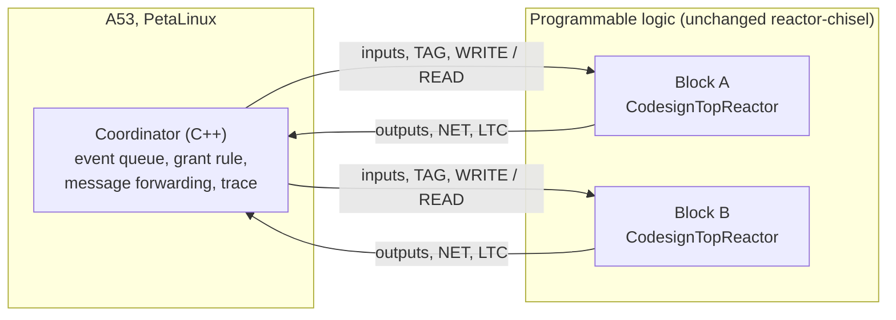

# Minimal LF Hardware Federation on the ZCU106 — Specification

| | |
|---|---|
| Status | Draft, revision 0.1, 10 November 2026 |
| Purpose | The simplest implementation that runs two reactor-chisel hardware blocks as one LF federation on the ZCU106 under final grants |
| Relation to other documents | Implements milestone M-A2 of the [full project definition](lf_hardware_coordination_project_definition.md) in its smallest form. That document stays the reference for everything this one leaves out. |

## 1 Idea in one paragraph

Each hardware block keeps the coordination interface the Codesign flow already generates: `tagAdvanceGrant`, `nextEventTag`, `logicalTagComplete`, `WRITE` and `READ`. No RTL is changed. One C++ program on the A53, the **coordinator**, drives both blocks. It executes tags in increasing order. At each tag it runs the blocks that have work in dependency order: it writes their inputs and grant, waits for completion, reads their outputs and forwards them to the other block. This is the loop the Codesign compiler already generates for one block ([wrapper L405–L424](https://github.com/erlingrj/lingua-franca/blob/f60c83c5fbf0f0c26c780c28e58e50c0fc60a608/core/src/main/java/org/lflang/ast/CodesignFpgaWrapperTransformation.java#L405-L424)), extended to two blocks.

Because every message passes through the coordinator before the receiver's grant, no input can be missing when a block executes. That removes the input-closure, in-transit and early-completion problems of the full design. The price is that the two blocks never execute at the same time.

## 2 Architecture



*Figure 1. The coordinator owns every decision, every message in flight and the trace. Each block owns only its own execution of a granted tag. The blocks are not connected to each other.*

## 3 Coordinator rule

Program model: two blocks, A and B. Connections between them have either no `after` or a positive `after d`, and the topology is acyclic. The coordinator knows, from a configuration file, the connections, their delays and a fixed order in which A comes before B.

```text
queue := {}                       # pending (tag, block, inputs) entries, ordered by tag;
                                  # entries with the same tag and block are merged
for each block X: queue.add(NET(X), X)          # initial local events read from nextEventTag
loop until stop tag or queue empty:
    t := smallest tag in queue
    for X in [A, B]:                            # fixed dependency order
        if X has an entry at t:
            write X's input values and present bits for t
            tagAdvanceGrant(X) := t ; command(X) := WRITE
            wait until logicalTagComplete(X) == t
            read X's outputs ; command(X) := READ
            for each output o of X with value v, to block Y with delay d:
                queue.add(t + d, Y, o := v)     # d = 0 keeps the same tag; Y comes later in the order
            queue.add(NET(X), X)                # next local event, if any
            log (t, X, inputs, outputs)
    queue.remove(t)
```

Why it is correct: the loop is a sequential LF execution that treats each block as one reactor. Tags are processed in order, and within a tag every upstream block runs before its downstream block. Every input for (t, X) is therefore in the queue before X is granted t, and absent inputs are known to be absent. The test is a trace comparison with the same program run as ordinary software LF (T-4).

## 4 Interface constraints the coordinator must respect

These come from the pinned source (reactor-chisel `d94dd2d`, compiler `f60c83c`) and replace any adapter RTL:

| Constraint | Coordinator behaviour | Source |
|---|---|---|
| Tags are 32-bit unsigned nanoseconds with no microstep; `NEVER` compares above `FOREVER` | Use time relative to start; keep runs under 2.1 s; never send a sentinel; forbid `after 0` | [`Tag.scala` L4–L29](https://github.com/erlingrj/reactor-chisel/blob/d94dd2d272ce46145ac13c3c6a141bc2ba9dfca1/src/main/scala/Tag.scala#L4-L29) |
| A grant above `nextEventTag` triggers an assertion | Grant exactly the tag being executed, which is never above the block's NET | [`Scheduler.scala` L48](https://github.com/erlingrj/reactor-chisel/blob/d94dd2d272ce46145ac13c3c6a141bc2ba9dfca1/src/main/scala/Scheduler.scala#L48) |
| A command is forwarded only when its value changes | Always alternate `WRITE` and `READ` per block, as the generated loop does | [`CodesignTopReactor.scala` L16–L28](https://github.com/erlingrj/reactor-chisel/blob/d94dd2d272ce46145ac13c3c6a141bc2ba9dfca1/src/main/scala/CodesignTopReactor.scala#L16-L28) |
| Completion is reported when every output port has fired; `reactionDone` defaults to true | Use only test reactors with at least one output and single-cycle reactions | [`CodesignTopReactor.scala` L76–L122](https://github.com/erlingrj/reactor-chisel/blob/d94dd2d272ce46145ac13c3c6a141bc2ba9dfca1/src/main/scala/CodesignTopReactor.scala#L76-L122), [`Reaction.scala` L144–L145](https://github.com/erlingrj/reactor-chisel/blob/d94dd2d272ce46145ac13c3c6a141bc2ba9dfca1/src/main/scala/Reaction.scala#L144-L145) |
| Local events also wait for the block's physical time to reach the tag | Expect real-time pacing; log physical time with every completion | [`Scheduler.scala` L36–L41](https://github.com/erlingrj/reactor-chisel/blob/d94dd2d272ce46145ac13c3c6a141bc2ba9dfca1/src/main/scala/Scheduler.scala#L36-L41) |
| The generated wrapper rebuilds a 64-bit NET as `nextEventTag + (now >> 32)` (suspected defect) | Do not reuse that line; read `nextEventTag` as a 32-bit offset from start | [wrapper L423–L424](https://github.com/erlingrj/lingua-franca/blob/f60c83c5fbf0f0c26c780c28e58e50c0fc60a608/core/src/main/java/org/lflang/ast/CodesignFpgaWrapperTransformation.java#L423-L424) |

## 5 The one hardware question

The rule needs two independently addressable `CodesignTopReactor` instances in one bitstream. The Codesign compiler generates one hardware block per program, and the ZCU106 port's platform wrapper has not been inspected. Step S1 answers this. If two instances are not possible, the fallback is one hardware block and one software block: B becomes a C++ reactor inside the coordinator and the rule is unchanged.

## 6 Steps

| Step | Work | Done when |
|---|---|---|
| S0 | Record the port's revisions (reactor-chisel, LF fork, Vivado, PetaLinux); rebuild and run the original Codesign example | The original example's output is reproduced on the board |
| S1 | Put two Codesign blocks in one design, each at its own register base | Software can read `nextEventTag` of both blocks and drive each one alone |
| S2 | Write the coordinator (Section 3) and its configuration file | T-1 to T-3 pass on the board |
| S3 | Run the test program and its software reference; compare traces | T-4 and T-5 pass |

## 7 Test program and tests

Test program: A has a 10 ms timer and sends a counter to B with `after 5 ms`. B has a 15 ms timer and one input from A, and outputs the sum of what it has seen. The run stops at 200 ms.

| Test | Checks |
|---|---|
| T-1 | Each block executes only after a grant; a block never executes twice for one tag |
| T-2 | At every tag where A sent a value, B executes with the input present and the same value |
| T-3 | At every tag where B executes from its timer only, the input is absent |
| T-4 | The trace (tag, block, input presence, values) equals that of the same program as software LF, event for event |
| T-5 | No assertion fires; both blocks and the coordinator reach the stop tag |

Logged per execution: tag, block, inputs, outputs, and the physical time at grant and at completion. Performance numbers (grant-to-completion time, polling cost) are reported apart from T-1 to T-5 and labelled as board measurements.

## 8 Left out on purpose

These items are left out on purpose; each one is in the full project definition:

- Parallel execution of A and B. A later step can let B run at tag t while A runs ahead, once A has completed every tag that could still send to B at t.
- The participant adapter RTL, wider tags, microsteps and `after 0`.
- The HW-RTI, any data path between blocks, and in-transit accounting.
- Decentralized coordination (micro-LF), fabric channels and the fabric counter.
- Reset, backpressure and tardiness tests.

## 9 References

1. `erlingrj/reactor-chisel`, commit `d94dd2d272ce46145ac13c3c6a141bc2ba9dfca1` (5 June 2024), `src/main/scala/`: `Tag.scala`, `Scheduler.scala`, `CodesignTopReactor.scala`, `Reaction.scala`.
2. `erlingrj/lingua-franca`, commit `f60c83c5fbf0f0c26c780c28e58e50c0fc60a608` (7 January 2024), `core/src/main/java/org/lflang/ast/CodesignFpgaWrapperTransformation.java`.
3. [Full project definition](lf_hardware_coordination_project_definition.md), revision 0.1, 9 November 2026.
